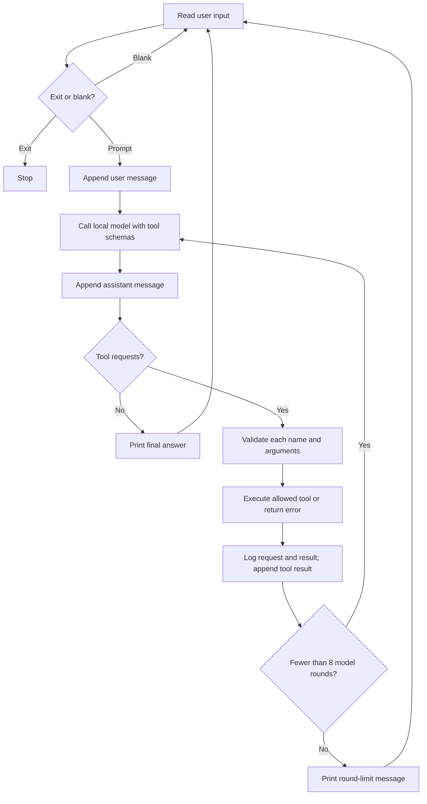

# Local Nemotron inventory agent

A small Python harness that runs Nemotron through a local Ollama server. The model requests inventory tools; Python validates and executes only allowed functions, then feeds results back to the model.

## Scope

Read-only, hard-coded sample data:

| Item | Current stock | Units sold in last 7 days |
| --- | ---: | ---: |
| Widget | 12 | 14 |
| Gadget | 0 | 7 |

No database, purchases, stock mutations, or arbitrary code execution tool. Recommendations are text, never orders.

## Setup

Install Python 3.14 and [Ollama](https://ollama.com/download). Start Ollama (the desktop app normally starts the server; otherwise run `ollama serve` in another terminal). Download the model:

```sh
ollama pull nemotron-3-nano:30b
```

Allow sufficient disk space and memory for this large model. No model weights are included here. Clone this repository and enter its directory.

Windows PowerShell:

```powershell
py -3.14 -m venv .venv
.\.venv\Scripts\python.exe -m pip install -r requirements.txt
.\.venv\Scripts\python.exe main.py
```

macOS or Linux with Python 3.14 installed:

```sh
python3.14 -m venv .venv
.venv/bin/python -m pip install -r requirements.txt
.venv/bin/python main.py
```

Type `/exit` to quit. Blank input is ignored. The client connects to `http://localhost:11434` with a 120-second request timeout and `num_ctx=4096`. Change `MODEL` in `main.py` to try another installed tool-capable model; behavior can differ.

The original working environment used Python 3.14.7, Ollama Python client 0.6.3, Ollama server 0.40.11, and `nemotron-3-nano:30b`, with an RTX 5080 (16 GB VRAM) and 64 GB RAM. An observed `ollama ps` report showed 44%/56% CPU/GPU, 4096 context, and roughly 25 GB model allocation. This is an observed configuration, not a minimum specification or speed benchmark. Model tags and transitive Python dependencies are not immutable; requirements pin the directly used client only.

## Tool-calling loop



`lookup_inventory(item_name)` distinguishes missing records from zero stock. `list_inventory_items()` discovers tracked names. `get_recent_sales(item_name)` returns seven-day sample sales totals. Names are trimmed and compared case-insensitively.

`execute_tool` enforces an explicit allowlist and argument objects, rejects extra or missing arguments, and requires nonempty item-name strings. Requests and results print to the terminal. Each user turn permits eight model calls. One response can contain multiple tool requests, so this cap does **not** cap total tool executions.

## Reproducible tests

After installing requirements, run with the virtual environment's Python:

```sh
python -m unittest discover -s tests -v
```

If the environment is not activated, use `.\.venv\Scripts\python.exe` on Windows or `.venv/bin/python` elsewhere. The 16 standard-library unittest tests cover sample data, missing versus zero stock, validation, allowlisting, unchanged data, conversation history, tool-result feedback, and round limits. Model responses are mocked: no Ollama server, GPU, model download, or network call is required during tests. All 16 tests passed locally on Python 3.14.7. Automated CI is not configured.

## Manual model evaluation

Start a fresh process for each prompt to avoid earlier conversation influencing results. Inspect both the answer and printed tool requests/results.

| Prompt | Expected behavior |
| --- | --- |
| How many Widgets are in stock? | Lookup Widget; report 12. |
| Is Gadget in stock? | Lookup Gadget; report out of stock / 0. |
| How many Foobars are in stock? | Lookup returns found=false; report no matching record, not zero. |
| Hello! | Short greeting without tools. |
| Check all tracked items. For any out-of-stock item, recommend enough units for the next seven days using its last seven days of sales. Show your evidence; do not place an order. | List Widget and Gadget, check both stocks, retrieve Gadget sales, recommend 7 Gadgets from stock 0 and seven-day sales 7. No order placed. |

These five cases were reported passing in the original interactive session. They are manual observations, not automated guarantees. Tool order and wording can vary. Unit tests verify the harness with mocked responses; they do not establish real-model compliance or accuracy.

## Limitations

- Prompt compliance is not deterministic enforcement. The model can skip tools, misread results, or make unsupported claims.
- The allowlist and argument validation enforce dispatch boundaries, not production safety.
- History stays in process memory until exit. The Python message list grows across turns while model context is bounded. There is no explicit history trimming or durable memory.
- The round cap bounds model calls per user turn, not total tool calls, tokens, latency, or session length.
- Connection and model errors are not retried or gracefully recovered. Ensure Ollama is running and the model is installed.
- Inference requests go to the local server. Installation and model downloads require network access. Terminal output can contain prompts and tool arguments; avoid private data.
- Sample sales are fixed data, not live analytics or a reliable forecast. This is not a production inventory or purchasing system.
